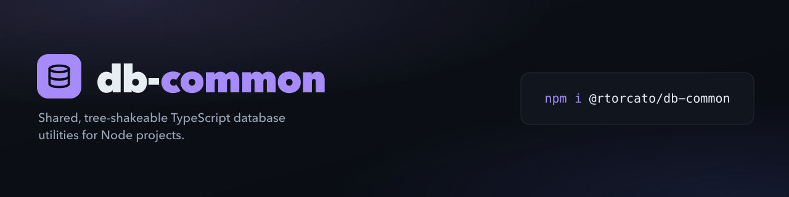

<!-- brand-kit:banner:start -->
<picture>
  <source media="(max-width: 640px)" srcset="./brand/banner-mobile.png">
  
</picture>
<!-- brand-kit:banner:end -->

# db-common

[](https://github.com/rtorcato/db-common/actions/workflows/ci.yml)
[](https://www.npmjs.com/package/@rtorcato/db-common)
[](https://www.npmjs.com/package/@rtorcato/db-common)
[](https://bundlephobia.com/package/@rtorcato/db-common)
[](https://opensource.org/licenses/MIT)
[](https://buymeacoffee.com/rtorcato)

> Shared, tree-shakeable TypeScript database utilities.

📖 **Docs:** https://docs.torcato.dev/db-common/

## Description

`db-common` is a collection of small, focused, database-agnostic helpers —
pagination, query shaping, result mapping — built the same way as the other
torcato.dev libraries: TypeScript-first, tree-shakeable, with zero
runtime dependencies. Ships as ESM and CommonJS for broad compatibility.

> See the [milestones](https://github.com/rtorcato/db-common/milestones) for what's planned next.

## Installation

```bash
pnpm add @rtorcato/db-common
# or
npm install @rtorcato/db-common
# or
yarn add @rtorcato/db-common
```

## Usage

Every helper returns a **plain shape** you feed to your own driver or query
builder — `db-common` never generates SQL, so it stays driver-agnostic and
zero-dependency.

```ts
import { paginate, orderBy, where, cursorPaginate } from '@rtorcato/db-common'

// Offset pagination — clamps junk query-string input to page/size ≥ 1.
paginate({ page: 2, size: 25 })
// → { limit: 25, offset: 25 }

// Sort parsing — leading "-" means descending; accepts a string or array.
orderBy('name,-createdAt')
// → [{ col: 'name', dir: 'asc' }, { col: 'createdAt', dir: 'desc' }]

// Filter normalization — bare values are `eq`, objects use operator keys.
where({ status: 'active', age: { gte: 18 } })
// → [{ col: 'status', op: 'eq', val: 'active' },
//    { col: 'age', op: 'gte', val: 18 }]

// Keyset (cursor) pagination — fetch limit+1 rows, then encodeCursor the last.
cursorPaginate({ size: 20, column: 'id', after })
// → { limit: 20, where: [{ col: 'id', op: 'gt', val: … }], order: [{ col: 'id', dir: 'asc' }] }
```

The package targets Node.js ≥22 and ships as both ESM and CommonJS.

## Drizzle adapters

[`@rtorcato/db-drizzle`](packages/db-drizzle) turns those shapes into Drizzle ORM
queries on Postgres. It's a separate package so `db-common` stays driver-agnostic.

```bash
pnpm add @rtorcato/db-drizzle drizzle-orm
# + pg for @rtorcato/db-drizzle/connection, drizzle-kit for @rtorcato/db-drizzle/config
```

```ts
import { orderBy, paginate, where } from '@rtorcato/db-common'
import { toDrizzleOrderBy, toDrizzleWhere, withPage } from '@rtorcato/db-drizzle'

const cols = { status: users.status, name: users.name }

const rows = await withPage(
  db
    .select()
    .from(users)
    .where(toDrizzleWhere(where({ status: 'active' }), cols))
    .orderBy(...toDrizzleOrderBy(orderBy('name'), cols)),
  paginate({ page: 2, size: 25 })
)
```

Peer dependencies and an example for each adapter are in the
[Drizzle adapters guide](https://docs.torcato.dev/db-common/guides/drizzle).

## Use with AI

A skill ships with the package so AI coding tools use db-common the way it's meant to be used.

**Any agent with the [`skills`](https://www.npmjs.com/package/skills) CLI** — install it straight from GitHub, no clone, no package install:

```bash
npx skills add https://github.com/rtorcato/db-common --skill db-common
```

**[Claude Code](https://claude.com/claude-code)** — register the marketplace once, then install the plugin:

```bash
/plugin marketplace add rtorcato/db-common
/plugin install db-common@db-common
```

**Other tools (Cursor, Copilot, Codex)** — the package ships an [`AGENTS.md`](AGENTS.md) with the same rules; agents that read `AGENTS.md` pick it up from `node_modules`, or copy the rules into your project's agent config.

## Development

```bash
pnpm install        # install dependencies
pnpm build          # build the library (tsup)
pnpm test           # run tests (vitest)
pnpm verify         # typecheck + biome check + test
```

### Scripts

- `pnpm typecheck` — type check TypeScript
- `pnpm check` / `pnpm check:fix` — lint & format with Biome
- `pnpm test` / `pnpm test:watch` — run tests
- `pnpm coverage` — generate test coverage
- `pnpm build` — build for production

## Documentation site

The docs live in [`apps/docs`](./apps/docs) (Docusaurus) and deploy to GitHub
Pages on every push to `main` that touches docs or `src/`.

```bash
pnpm --filter @rtorcato/db-common-docs dev     # local preview
pnpm --filter @rtorcato/db-common-docs build   # production build
```

## Project structure

```
db-common/
├── src/                  # library source
├── apps/docs/            # Docusaurus documentation site
├── scripts/              # build/maintenance scripts (changelog, AGENTS.md sync)
├── skills/db-common/     # AI skill (SKILL.md, source of truth for AGENTS.md)
├── .claude-plugin/       # Claude Code marketplace + plugin manifests
├── AGENTS.md             # generated from SKILL.md by `pnpm sync:agents`
├── package.json
├── tsconfig.json
├── biome.jsonc
├── vitest.config.ts
├── tsup.config.ts
└── .husky/               # git hooks
```

## Sibling projects

- [@rtorcato/js-common](https://rtorcato.github.io/js-common/) — general TypeScript utilities
- [@rtorcato/browser-common](https://rtorcato.github.io/browser-common/) — browser Web API wrappers
- [@rtorcato/repo-tooling](https://rtorcato.github.io/repo-tooling/) — shared Biome/TS/Vitest/release presets

## Contributing

This project follows [Conventional Commits](https://conventionalcommits.org/):
`feat:`, `fix:`, `docs:`, `style:`, `refactor:`, `test:`, `chore:`.
See [CONTRIBUTING.md](CONTRIBUTING.md) for setup and the PR workflow, and
[SECURITY.md](SECURITY.md) to report a vulnerability.

## License

MIT © Richard Torcato
